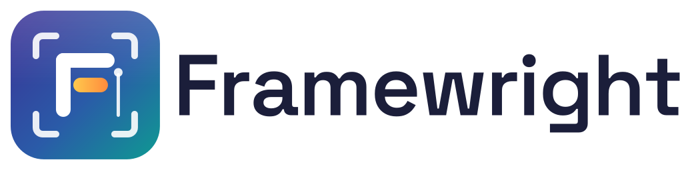

<h1>
  <picture>
    <source media="(prefers-color-scheme: dark)" srcset="resources/logo-dark.svg">
    
  </picture>
</h1>

Framewright is an AI-native video editor for Linux. It has a multi-track timeline, AI generation with your own API keys, and a built-in MCP server, so Claude Desktop, Claude Code, Codex, Cursor and other agents can open and edit your projects.

Framewright is based on [Palmier Pro](https://github.com/palmier-io/palmier-pro) (GPLv3) by Palmier, Inc. It is a Linux port of Palmier Pro v0.7.6, the last GPLv3 release. See [NOTICE](NOTICE) for the attribution and the list of changes.

## Features

- **Editor:** media library with folders, multi-track timeline (ripple trim and delete, slip, razor, linked audio/video), keyframes, transitions, text and captions, color adjustments and curves, crop and transform, blend modes, multicam, nested sequences, markers, undo history.
- **Export:** MP4 (H.264 / H.265), MOV (ProRes, HEVC 10-bit HLG), WebM, GIF, PNG stills, audio-only (M4A, WAV), Final Cut Pro XML (FCPXML), Premiere / Resolve XML, and self-contained project packages.
- **In-app agent:** chat with an AI agent that edits your timeline. Uses your Anthropic or OpenAI API key. Each agent action is one undo step.
- **AI generation (bring your own keys):** video, image, music, speech and sound effects through fal, Google (Gemini) and ElevenLabs. Also AI edits, upscaling and AI transitions.
- **On-device AI:** transcription and captions with whisper.cpp, visual search (describe a shot to find it), silence and beat detection, audio sync, speaker labels and voice denoise. Models download on first use and run locally.
- **MCP server:** the same 50-tool contract as Palmier Pro, on `http://127.0.0.1:19789/mcp` by default.
- **28 languages.** Choose one in Settings ▸ General ▸ Language.

## Install

Download the AppImage or the `.deb` from the [releases page](https://github.com/NikhilDhaliya/framewright/releases).

```bash
# AppImage
chmod +x Framewright-0.1.0-x86_64.AppImage
./Framewright-0.1.0-x86_64.AppImage

# Debian / Ubuntu
sudo apt install ./Framewright-0.1.0-amd64.deb
```

Requirements: x86-64 Linux with glibc 2.34 or newer (needed for local transcription). A GPU is recommended for smooth preview playback.

## Bring your own API keys

Framewright has no account and no cloud service. AI features use your own keys. Add them in **Settings ▸ Models & API Keys**:

| Key | Used for |
|---|---|
| Anthropic or OpenAI | In-app agent chat |
| fal | Video, image and upscale models, AI edits, AI transitions |
| Google (Gemini API) | Nano Banana images, text-to-speech, Lyria music |
| ElevenLabs | Speech, music, sound effects, voice cleanup, dubbing, cloud transcription |
| OpenAI | Cloud transcription (optional; local whisper.cpp is the default) |

Keys are stored with your system keyring (Secret Service / KWallet) when one is available.

Note: a Claude.ai subscription can't be used by third-party apps. If you have a subscription and no API key, use Claude Desktop or Claude Code through MCP instead (see below).

## Connect Claude and other agents (MCP)

Framewright starts an MCP server on `http://127.0.0.1:19789/mcp` while it is open. You can change the port in Settings. **Help ▸ MCP** shows the exact commands for your setup.

**Claude Code**

```bash
claude mcp add --transport http framewright http://127.0.0.1:19789/mcp
```

**Codex**

```bash
codex mcp add framewright --url http://127.0.0.1:19789/mcp
```

**Cursor:** use **Help ▸ MCP ▸ Install in Cursor**, or add this to `~/.cursor/mcp.json`:

```json
{ "mcpServers": { "framewright": { "type": "http", "url": "http://127.0.0.1:19789/mcp" } } }
```

**Claude Desktop:** Claude Desktop has no official Linux build. Where you run it (macOS, Windows, or a community Linux build on the same computer as Framewright), install `framewright-0.1.0.mcpb` from the releases page by opening it with Claude Desktop. The extension is a small stdio bridge to the running app and reconnects when Framewright restarts. It reads the port from `~/.config/framewright/settings.json`; set `FRAMEWRIGHT_MCP_URL` to override it. The server only listens on 127.0.0.1.

Then ask, for example, "Add the three newest clips to the timeline and put captions on the interview."

## Build from source

Requires Node.js 22 and npm.

```bash
npm install          # also downloads ffprobe, deep-filter and two models into resources/ (pinned, sha256-checked)
npm run build        # compile main, preload and renderer into out/
npm start            # build and run
npm run dev          # run with live reload
npm run typecheck
npm test             # vitest
node scripts/smoke-render.mjs   # render and export end-to-end check (needs xvfb-run)
```

## Packaging

```bash
npm run dist
```

This builds the app and writes to `dist/`:

- `Framewright-<version>-x86_64.AppImage`
- `Framewright-<version>-amd64.deb`
- `framewright-<version>.mcpb` (the Claude Desktop extension, from `resources/mcpb/`; `npm run mcpb` builds only this)
- `ffmpeg-7.0.2.tar.xz`, the source of the bundled FFmpeg build. Attach it to every release next to the AppImage and `.deb` (FFmpeg is GPLv3, so its source has to be available from the same place). The sources of the libraries linked into that build are listed in [`licenses/FFmpeg-build-sources.txt`](licenses/FFmpeg-build-sources.txt); link it from the release notes.

`npm run dist` also regenerates `THIRD_PARTY_LICENSES.txt` (`npm run licenses` does only this). Run it after changing dependencies and commit the result.

The app icon is drawn in `resources/icon.svg`. To regenerate the PNG sizes in `resources/icons/` run `npm run icons` (needs `xvfb-run`).

## Files and folders

| Path | Contents |
|---|---|
| `~/.config/framewright/` | Settings |
| `~/.local/share/framewright/Models/` | Downloaded models |
| `~/.cache/framewright/` | Transcripts, search index, audio analysis |
| `~/.local/state/framewright/crash.log` | Crash log (stays on your computer) |
| `~/.framewright/skills/` | Agent skills |
| `~/Documents/Framewright/` | Default projects folder |

Projects are `.palmier` packages, the same format as Palmier Pro, so projects open in both apps. When you first start Framewright, it moves folders from an earlier `palmier-pro` install (and `~/.palmier/skills`) to the new locations. Environment variables can use the `FRAMEWRIGHT_` prefix. The older `PALMIER_` names still work.

## License

Framewright is free software under the [GNU General Public License v3](LICENSE) (GPL-3.0-only).

Copyright (C) 2026 Palmier, Inc. (Palmier Pro, the original work).
Linux port and modifications Copyright (C) 2026 Nikhil Dhaliya.

Framewright is not affiliated with or endorsed by Palmier, Inc. "Palmier" and "Palmier Pro" are names of Palmier, Inc. and are used here only to credit the original work.
